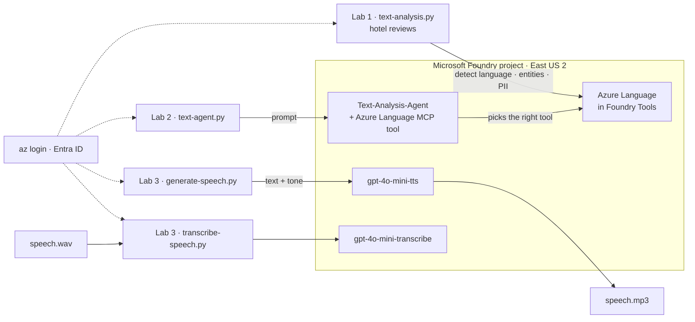

# Prince Hands-on Labs: Language and Speech AI with Microsoft Foundry

Three hands-on labs on one Microsoft Foundry project: **analyze text** with Azure Language, give an **AI agent** language tools through **MCP**, and make apps **speak and listen** with speech-capable generative models. All in Python, all keyless with Microsoft Entra ID.

| # | Lab | You build | Time |
|---|---|---|---|
| 1 | [Analyze text with Azure Language](lab1-analyze-text/README.md) | A hotel-review pipeline: language detection, entity extraction, **PII redaction** | ~30 min |
| 2 | [Text analysis agent with the Azure Language MCP tool](lab2-text-analysis-agent/README.md) | A Foundry agent that **chooses** NLP tools (entities, sentiment, PII) + a Python client | ~45 min |
| 3 | [Speech generation and transcription](lab3-speech-models/README.md) | Text-to-speech with **gpt-4o-mini-tts** and speech-to-text with **gpt-4o-mini-transcribe** | ~40 min |

| | |
|---|---|
| **For** | AI engineers and developers |
| **Level** | Beginner to intermediate |
| **Cost** | About US $0.10 for all three if you [clean up](docs/cleanup.md) |
| **You need** | Azure subscription (Owner/Contributor, Free Trial works), VS Code, **Python 3.13**, Git, Azure CLI |



## Start here (once)

| Step | Page |
|---|---|
| 0 | [Prerequisites and cost](docs/00-prerequisites-and-cost.md) |
| 1 | [Create one Foundry project for all labs](docs/01-create-foundry-project.md) |
| 2 | [Set up VS Code, Python and Azure sign-in](docs/02-setup-vscode.md) |

Then do the labs in order: [Lab 1](lab1-analyze-text/README.md) → [Lab 2](lab2-text-analysis-agent/README.md) → [Lab 3](lab3-speech-models/README.md).

Finish with: [Share your learnings](docs/share-your-learnings.md) · [**Clean up**](docs/cleanup.md) · [Troubleshooting](docs/troubleshooting.md) · [Interview questions](docs/interview-questions.md)

## Repository layout

```
foundry-ai-language-labs/
├── README.md
├── requirements.txt                     ← one environment for all labs (pinned, tested)
├── docs/                                ← setup, share, clean up, troubleshooting, interview prep
├── lab1-analyze-text/
│   ├── README.md                        ← click-by-click guide
│   └── text-analysis/  text-analysis.py · reviews/ · .env.example · solution/
├── lab2-text-analysis-agent/
│   ├── README.md
│   └── text-agent/     text-agent.py · .env.example · solution/
└── lab3-speech-models/
    ├── README.md
    ├── generate-speech/    generate-speech.py · .env.example · solution/
    └── transcribe-speech/  transcribe-speech.py · speech.wav · .env.example · solution/
```

## What's fixed compared with the original exercises

| Problem you'd hit | Fix in this repo |
|---|---|
| Three separate setups, three resource groups, wrong region for some models | **One project in East US 2** that supports all three labs, one resource group `rg-prince-language` |
| Snippets shown without their real indentation (code goes inside `try` and `for` blocks) | Every snippet states its indentation (0 / 8 / 12 spaces) and matches a tested `solution/` file |
| Lab 1: you had to manually strip `/api/projects/...` from the endpoint | The app trims it for you |
| Lab 1: `reviews` folder only found when run from one exact folder | Paths resolve from the script's own location |
| Lab 2: pre-release SDK pin (`azure-ai-projects==2.0.0b4`) | GA `azure-ai-projects 2.3.0` with a compatible `openai` pin |
| Lab 2: if tool approval isn't automatic, the app prints an **empty** answer | The app detects the approval request and says exactly what to change |
| Lab 2: project vs resource endpoint confusion; case-sensitive agent name | Clear `.env.example`, plus a check that stops with a helpful message |
| Lab 3: "Target URI" pasted as-is breaks the client (needs only `https://<resource>…/`) | The app trims any pasted URI to the right base |
| Lab 3: playback crashes on machines/VMs without audio, hiding that the model call worked | Playback is optional; the app prints where the audio file is |
| Lab 3: audio file opened and never closed | `with open(...)` |
| Lab 3 description mentioned a Speech SDK and Speech resource that the code doesn't use | Guide describes what's really built: gpt-4o-mini-tts / -transcribe via the OpenAI SDK |
| `.env` files with placeholders committed | `.env.example` + `.gitignore`; no endpoint or key is ever pushed |
| Python 3.14 breaks installs; `Activate.ps1` blocked | 3.13 required and checked; `Set-ExecutionPolicy -Scope Process` included |
| 401/403 with keyless auth (missing data-plane role) | Troubleshooting shows the exact role to assign |
| Empty troubleshooting sections | 13 common errors with fixes |

## Documentation

- Azure Language in Foundry Tools: <https://learn.microsoft.com/azure/ai-services/language-service/overview>
- Microsoft Foundry: <https://learn.microsoft.com/azure/ai-foundry/>
- Foundry Agent Service: <https://learn.microsoft.com/azure/foundry/agents/overview>
- Speech-capable models (gpt-4o-mini-tts / -transcribe): <https://ai.azure.com/catalog/models/gpt-4o-mini-tts> · <https://ai.azure.com/catalog/models/gpt-4o-mini-transcribe>

> Some features used here are in **preview**; portal labels can change. If a button name differs, look for the closest match and check [Troubleshooting](docs/troubleshooting.md).

## Summary

Across the three labs you:

- **Created one Microsoft Foundry project** and signed in keylessly with Entra ID.
- **Detected language, extracted entities and redacted PII** from hotel reviews with Azure Language.
- **Built a text analysis agent** connected to the **Azure Language MCP server**, set tool approval, and called it from Python while inspecting which tools it chose.
- **Generated speech** with tone control and **transcribed speech** with gpt-4o-mini models.
- **Cleaned up** all Azure resources.

---

*Prince Hands-on Labs. Based on Microsoft Learn's open-source exercises ([MicrosoftLearning/mslearn-ai-language](https://github.com/MicrosoftLearning/mslearn-ai-language)), MIT licence (see [LICENSE](LICENSE)), updated and fixed for classroom use. Contoso, Margie's Travel and the hotel reviews are fictional sample data.*
